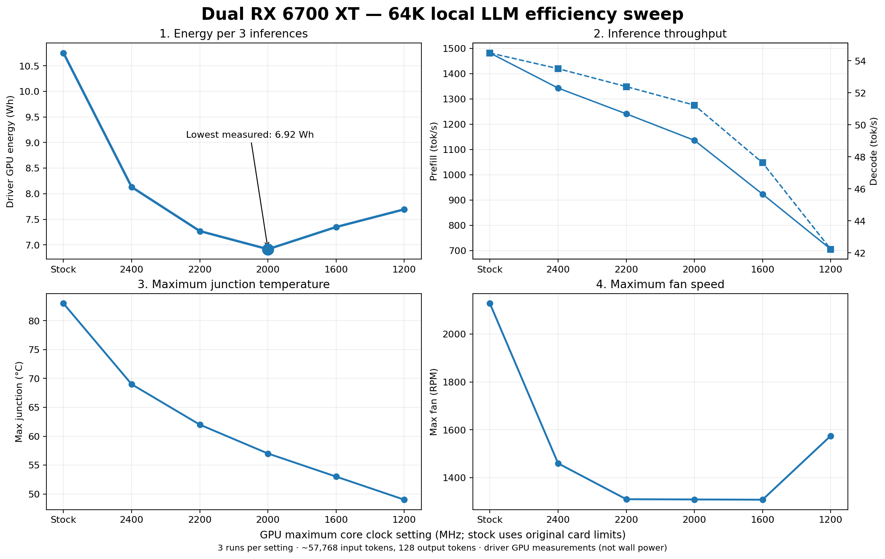
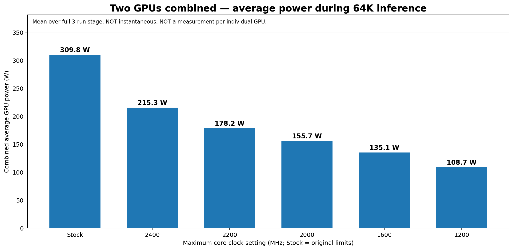

# AMDGPU inference efficiency tools

An open-source Linux toolkit for exploring **GPU power, temperature, noise proxies and energy per inference task**. Ships a read-only AMDGPU terminal viewer, an **experimental** inference-request pacing proxy, and an openly shared six-point GPU clock-sweep benchmark. No auto-tuning or GPU clock-writing utility is included in this release.

## AMDGPU terminal viewer

`viewer/amdgpu_smi.py` implements `nvidia-smi`-style ASCII frames with sampled AMDGPU sensor values: **0.5 s polling**, 3 s rolling LIVE averages for utilization/clocks/fans/power, a **60 s peak hold**, and GREEN/YELLOW/RED summary status. Temperature and VRAM occupancy in LIVE are instantaneous. **Read-only**: it never changes GPU clocks, power limits or fans.

Python 3.10+ on a Linux AMDGPU system; no Python packages required:

```bash
python3 viewer/amdgpu_smi.py --demo
python3 viewer/amdgpu_smi.py --once --color never
python3 viewer/amdgpu_smi.py
```

Optional Docker mode (Linux, mounts host `/sys` read-only):

```bash
docker build -t amdgpu-smi:local ./viewer
docker run --rm -it --network none --read-only --cap-drop ALL \
  --security-opt no-new-privileges \
  --mount type=bind,src=/sys,dst=/sys,readonly \
  amdgpu-smi:local
```

See [viewer documentation](docs/viewer.md). No privileged GPU-device access is needed by the viewer; sensor availability varies by kernel/driver.

## Benchmark: dual RX 6700 XT, Gemma 4 26B-A4B Q4_0, 64K context

The hardware and six actual benchmark measurements below have been **explicitly approved for public disclosure by the experiment owner**. The LLM input was synthetic technical text; no confidential prompts, personal media or private research source code is included.

- **GPUs:** 2 × AMD Radeon RX 6700 XT, 12 GiB per card; one inference engine distributed over both GPUs.
- **Inference:** local llama.cpp/ROCm running Gemma 4 26B-A4B Q4_0 GGUF.
- **Workload:** context limit 65,536 tokens; approximately 57,768 input tokens, 128 output tokens; three sequential requests per clock setting.
- **Controls:** both GPUs at the indicated maximum core clock (except unmodified stock: 2709/2614 MHz); maximum VRAM clock 1000 MHz, voltage offset 0 mV.
- **Measurement:** aggregate driver-reported GPU power samples integrated to Wh across the stage; temperatures and fan speeds are observed stage peaks, not sound pressure.

| GPU max clocks | Avg combined GPU W | GPU Wh / 3 requests | Prefill t/s | Decode t/s | Max junction °C | Max fan RPM |
|---|---:|---:|---:|---:|---:|---:|
| Stock (2709 / 2614 MHz) | 309.82 | 10.7515 | 1482 | 54.49 | 83 | 2128 |
| 2400 / 2400 MHz | 215.33 | 8.1310 | 1343 | 53.51 | 69 | 1460 |
| 2200 / 2200 MHz | 178.19 | 7.2699 | 1241 | 52.39 | 62 | 1310 |
| **2000 / 2000 MHz** | **155.74** | **6.9156** | **1136** | **51.23** | **57** | **1309** |
| 1600 / 1600 MHz | 135.08 | 7.3492 | 923 | 47.63 | 53 | 1308 |
| 1200 / 1200 MHz | 108.68 | 7.6949 | 705 | 42.23 | 49 | 1575 |





**Observed result:** at the 2000 MHz setting, **35.7% less driver-reported GPU energy** was measured per three-request benchmark than at stock. Lowering the clock further to 1600 or 1200 MHz **increased energy per task** despite reducing average watts: the workload took longer.

**Do not generalize these measurements:** this is a prefill-heavy workload, one three-request stage per setting, not randomized for thermal starting state. Combined GPU-only energy is **not total system wall energy**, and the combined average wattage is **not instantaneous or per-card GPU power**. The six-point summary cannot truthfully supply instantaneous per-card traces. Per-card power can be computed from local raw sensor logs with the included `benchmarks/export_per_gpu_power.py` and `benchmarks/plot_per_gpu_power.py`; raw logs and host identifiers are deliberately not distributed.

[Methodology and limitations](benchmarks/64k/methodology.md) · [Results CSV](benchmarks/64k/results.csv) · [Per-GPU data requirements](docs/per_gpu_power.md).

## Experimental request pacing proxy (not a hardware power throttle)

`governor/request_governor.py` can place idle time between OpenAI-compatible API requests:

```bash
python3 governor/request_governor.py init
python3 governor/request_governor.py set --factor 0.6
python3 governor/request_governor.py serve
```

Defaults: `127.0.0.1:18084` listener, `127.0.0.1:18083` upstream. **Do not expose to untrusted networks**: no built-in authentication. The proxy does not limit instantaneous GPU power, and the original 64K test showed that pacing alone did **not** reduce GPU Wh/task. [Documentation](docs/governor.md).

## Scope, safety and privacy

- No generic AMDGPU overdrive/clock-control installer is shipped. Hardware-specific tuning requires careful driver checks and a tested rollback path.
- No private prompts, photographs, videos, internal AI projects, workstations, LAN addresses, proprietary data pipelines, raw power traces or personal payment email addresses are distributed.
- All measurements are provided under the explicit owner authorization limited to **the listed hardware configuration and six benchmark result rows**. This does not authorize publishing any other private experimental data.
- Viewer is observational, not a safety controller. The request proxy is experimental, not a secure network gateway.
- Do not upload sensitive logs when reporting issues.

[Security policy](SECURITY.md) · [Contributing](CONTRIBUTING.md) · [MIT License](LICENSE).

**Support (optional):** Happy? Donate $1. Extremely happy? Donate $2. A public payment link may be added after its owner verifies it; no personal payment address is embedded here.
